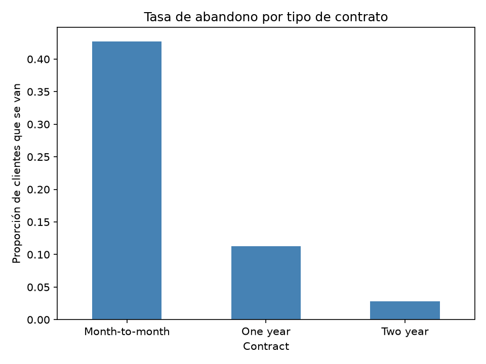

# Churn Prediction Pipeline

Pipeline de machine learning que predice qué clientes de una empresa de telecomunicaciones van a cancelar su servicio, desde los datos crudos hasta la predicción.

## Resultados

| Modelo | ROC-AUC | Precision (abandono) | Recall (abandono) |
|---|---|---|---|
| Regresión logística | 0.842 | 0.50 | 0.78 |
| Random forest | 0.823 | 0.55 | 0.63 |

La regresión logística detecta al 78% de los clientes que se van. Se priorizó el recall porque perder a un cliente cuesta más que ofrecerle una promoción a uno que no se iba.



Con contrato mes a mes se va el 43% de los clientes; con contrato de dos años, solo el 2.8%.

## Datos

Telco Customer Churn (IBM), versión clásica de 7043 clientes: [Kaggle](https://www.kaggle.com/datasets/blastchar/telco-customer-churn). Solo el 26.5% de los clientes abandona, por eso se evalúa con ROC-AUC, precision y recall en lugar de accuracy.

## Cómo ejecutarlo

```bash
git clone https://github.com/KdooQ/Churn-prediction-pipeline.git
cd Churn-prediction-pipeline
python -m venv .venv
.venv\Scripts\activate        # Mac/Linux: source .venv/bin/activate
pip install -r requirements.txt
python -m src.train
python -m src.predict
python -m pytest
```

## Decisiones técnicas

- Los `TotalCharges` vacíos corresponden a clientes nuevos sin facturas, así que se rellenan con 0.
- El preprocesamiento va dentro de un `Pipeline` de scikit-learn, para ajustarse solo con datos de entrenamiento y evitar fuga de información.
- Se usa `class_weight="balanced"` para compensar el desbalance de clases.
- Herramientas: Python, pandas, scikit-learn, pytest.